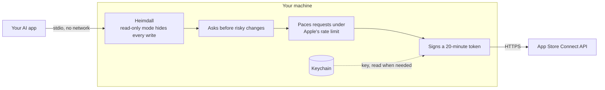
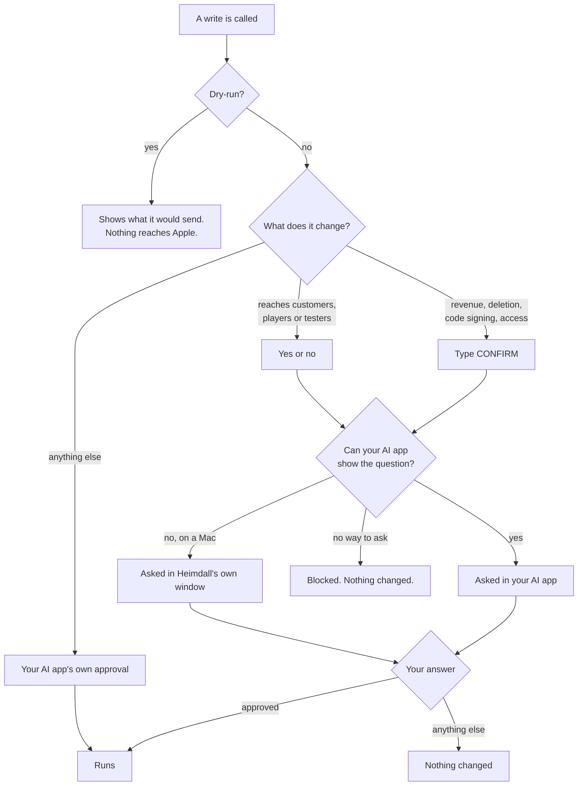

# Heimdall — App Store Connect MCP

**Your whole App Store Connect account, in one tool.**

<!-- Absolute URL on purpose: npm does not rewrite relative image paths. -->
<a href="#setup"></a>

[](https://www.npmjs.com/package/@erayendes/asc-mcp)
[](https://www.npmjs.com/package/@erayendes/asc-mcp)
[](https://github.com/erayendes/app-store-connect-mcp/actions/workflows/ci.yml)
[](LICENSE)
[](https://milowda.com)

🇬🇧 English · 🇹🇷 [Türkçe](docs/README_tr.md)

> **Heimdall 3.0 beta is here! 🎉**
>
> I released Heimdall three months ago. Since then it has been **downloaded more than 6,800 times** from npm, about 1,700 installs a month. It has passed **50 stars** on GitHub, with **37 releases** in 3 months. Thank you all; 3.0 is built on exactly the feedback you sent.
>
> 3.0 is the biggest update Heimdall has had:
> - **Profiles are cut by the work you do:** 13 profiles, 50 sub-profiles.
> - **Images and files now take just four tools:** we removed 73 separate ones. `media__list`, `media__upload`, `media__arrange` and `media__delete` handle everything from screenshots to build files.
> - **Everything you send to review goes in one call.**
> - **The confirmation dialog** is clear and plain.
>
> Everything that changed is in the [changelog](docs/CHANGELOG.md).
>
> If you see anything odd during the beta, I'd love to [hear about it](https://github.com/erayendes/app-store-connect-mcp/issues). To stay on the stable release, just leave `@beta` off.

**Ask, and it answers. Tell it, and it's done.**

> - *"Summarize this week's 1-star reviews and draft replies."*
> - *"Which builds are stuck in review?"*
> - *"Raise this subscription's price in every country."*
> - *"What does this subscription cost in each country?"*
> - *"Which screenshots are on the store listing?"*
> - *"Add build 42 to the Internal and External groups."*
> - *"Why did my Xcode Cloud build fail?"*

Almost anything you'd click through App Store Connect to do, you can now just ask your AI to do. More examples in the [Guide](docs/GUIDE_en.md#examples).

<!-- Absolute URL on purpose: npm does not rewrite relative image paths. -->


<sub>A real AI session, sped up. The App Store Connect account is a stand-in so the recording can be public.</sub>

### Heimdall

One package for the **App Store Connect API** and the **App Store Server API (StoreKit 2)**, built from Apple's own OpenAPI specification. **14 profiles, 50 sub-profiles, 762 tools.** Each profile runs as its own small MCP server.

Apple's specification lists 1011 API operations. Heimdall leaves out the 185 that Apple has deprecated or replaced with a newer version, and 19 that repeat another operation from the other side or that no task needs. Of the remaining 807, 710 become tools, and 52 hand-written ones join them: 762 tools in all. The other 97 are covered by the media tools, which do in one call what took several raw ones.

Most App Store Connect MCP servers give you a hand-picked slice of the API. That works until you need the one endpoint they left out, and then **you're off hunting for yet another tool.**

**Heimdall does the opposite: it gives you the whole API, cut by the work you do.** Releases, TestFlight, subscriptions and in-app purchases, the store page and reviews, Game Center, Xcode Cloud, provisioning, webhooks, sales and finance reports: each is a profile, and a big one splits into sub-profiles, so `monetization:subscription` loads subscriptions without the rest of the money tools. **You pick what you need**, and add or remove profiles whenever you like.

**ASC-Core comes with every profile.** Finding your apps, searching every tool, and the media tools are the same whatever you work on, so they run once, in a server of their own that setup registers next to your picks. The media tools handle every screenshot, video, image and file App Store Connect takes: store page media, App Clip and Game Center images, in-app purchase and subscription images, review screenshots and attachments, encryption documents, routing coverage, background asset and build upload files ([the full list](docs/MEDIA_TARGETS_en.md)).

[Profiles](docs/PROFILES_en.md) shows what each one covers, down to every tool. You don't have to memorize any of it, though: ask *"Is there a tool for in-app events?"* and Heimdall tells you which profile has it.

**Not sure which profiles you need?** The [starter packs](docs/PROFILES_en.md#starter-packs) suggest a set for your role.

### Runs on your machine

Most MCP guides recommend remote HTTP servers.
**Heimdall runs locally instead.** It reads your App Store Connect key from the Keychain, signs a short-lived token and talks to Apple directly. Nothing sits in between, so your key stays with you.



> [!NOTE]
> Give your key the narrowest role that does the job. [Roles](docs/ROLES_en.md) explains what each App Store Connect role can do.

### Asks before risky changes

Before changing a price, giving someone Admin access or deleting something, Heimdall asks you to confirm and shows what will change. By default it asks in two ways:

- **You type CONFIRM** for changes to revenue, deletions, code signing and access, and for the few steps that cannot be walked back: releasing a version, ending a pre-order, expiring a build. Assigning a build to beta groups in one call (`testflight__assign_build_to_groups`) asks for CONFIRM too.
- **You answer yes or no** for the other steps that reach customers, players or testers: sending something to review, starting a new subscription or in-app purchase version, changing a phased rollout, sending a build to external review, selling in a country, changing a product page test, sending a score or achievement for a player, changing the message customers see while cancelling a subscription, replying to a customer review.

Everything else goes through your AI app's own approval.



**If your AI app can't show the question** (like the Code tab in Claude Desktop), Heimdall asks in a window of its own on a Mac. Its button says what it does: Remove, Upload, Delete. The AI can neither see nor press it, and waits until you answer.


More in [Security](.github/SECURITY.md).

### Works alongside Fastlane
Heimdall doesn't replace [Fastlane](https://fastlane.tools/); it complements it. **Fastlane for the pipeline, Heimdall for everything you'd otherwise do by hand.**

### Setup

One command:

```bash
npx -y @erayendes/asc-mcp@beta setup
```

<!-- Absolute URL on purpose: npm does not rewrite relative image paths. -->


<sub>Setup in the browser: pick what you need and see what it costs the AI as you go. All four steps are in [Setup](docs/SETUP_en.md#save-your-credentials-once--the-setup-wizard).</sub>

This is the 3.0 beta; `@beta` picks it until 3.0.0 is out. For 2.8, leave `@beta` off.

It asks whether to continue in your browser (recommended) or the terminal. You'll need an [App Store Connect API key](docs/SETUP_en.md#create-an-api-key); the browser page tells you which role to give it from what you pick, so you can run setup before creating the key. Node.js 20.19 or later.

Setup does two things: it saves your key, and it registers the profiles you pick, with ASC-Core beside them, in every AI app it finds. Your AI can do the second half for you with `register`; the key is always yours to hand over, through `setup`.

Want your AI to install it for you, or to use it in [Xcode 27](docs/SETUP_en.md#using-heimdall-in-xcode-27)? Everything else is in [Setup](docs/SETUP_en.md).

### About the name and the project
In Norse mythology, **Heimdall** keeps watch over Bifröst, **the rainbow bridge that links Asgard to the nine realms**. Here, his job is to guard the road between your App Store Connect account and your machine. That's where the name comes from.

I build Heimdall on my own, in the evenings, and release it free and open source under the MIT license.
If it gets you out of the App Store Connect dashboard, it has done its job.

### License

[MIT](LICENSE) © Eray Endes

[SECURITY.md](.github/SECURITY.md) | [SUPPORT.md](.github/SUPPORT.md) | [CHANGELOG.md](docs/CHANGELOG.md) | [CONTRIBUTING.md](.github/CONTRIBUTING.md) | [CODE_OF_CONDUCT.md](.github/CODE_OF_CONDUCT.md) | [GOVERNANCE.md](.github/GOVERNANCE.md)

Heimdall is generated from the App Store Connect OpenAPI specification published by Apple Inc. App Store Connect, TestFlight, StoreKit, Xcode and Game Center are trademarks of Apple Inc. This project is not affiliated with Apple Inc.
