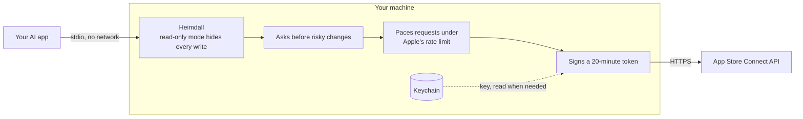
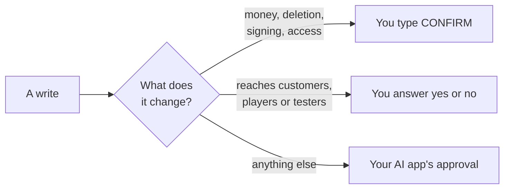
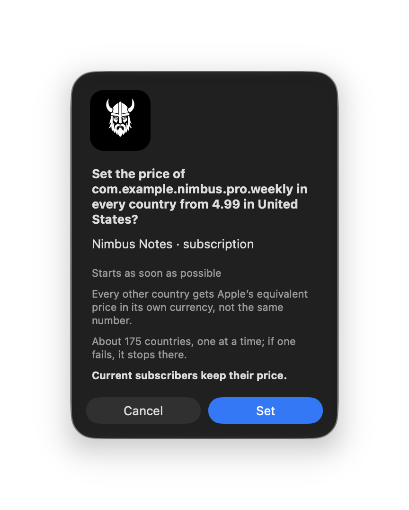
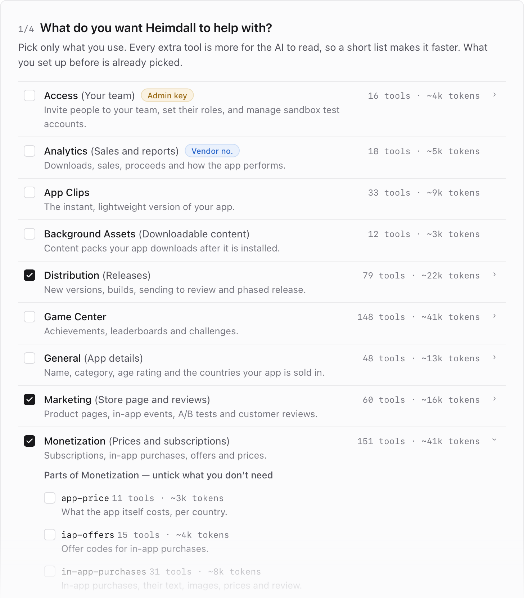

# Heimdall: App Store Connect MCP

**Run App Store Connect from your AI. Anything that costs money waits for your confirm.**

Price, offers and subscriptions in 175 countries, in one sentence.

[](https://www.npmjs.com/package/@erayendes/asc-mcp)
[](https://www.npmjs.com/package/@erayendes/asc-mcp)
[](https://github.com/erayendes/app-store-connect-mcp/actions/workflows/ci.yml)
[](LICENSE)
[](https://milowda.com)

🇬🇧 English · 🇹🇷 [Türkçe](docs/README_tr.md)

```bash
npx -y @erayendes/asc-mcp setup
```

[](https://cursor.com/en/install-mcp?name=ASC-Default&config=eyJjb21tYW5kIjoibnB4IiwiYXJncyI6WyIteSIsIkBlcmF5ZW5kZXMvYXNjLW1jcCJdfQ==)
[](https://insiders.vscode.dev/redirect/mcp/install?name=ASC-Default&config=%7B%22command%22%3A%22npx%22%2C%22args%22%3A%5B%22-y%22%2C%22%40erayendes%2Fasc-mcp%22%5D%7D)

The two buttons add **ASC-Default** to Cursor or VS Code: core, general and analytics, read-only. It starts without a key; reading your account needs one. To hand over your key and pick your profiles, run `npx -y @erayendes/asc-mcp setup` in a terminal, then remove the ASC-Default entry, since setup registers the profiles you picked.

<!-- Absolute URL on purpose: npm does not rewrite relative image paths. -->


<sub>A real AI session, sped up. The App Store Connect account is a stand-in so the recording can be public.</sub>


<sub>One anchor price, Apple equalizes the rest, and nothing is written until you type CONFIRM. Recorded against a stand-in account.</sub>

> **Heimdall 3.1 is out.** Start without a key in a read-only default, check your setup with `doctor`, and install from Cursor or VS Code in one click. Thank you for more than 6,800 npm downloads in three months. Everything that changed is in the [changelog](docs/CHANGELOG.md); if you see anything odd, please [open an issue](https://github.com/erayendes/app-store-connect-mcp/issues).

**Ask, and it answers. Tell it, and it's done.**

> - *"Summarize this week's 1-star reviews and draft replies."*
> - *"Which builds are stuck in review?"*
> - *"Raise this subscription's price in every country."*
> - *"What does this subscription cost in each country?"*
> - *"Which screenshots are on the store listing?"*
> - *"Add build 42 to the Internal and External groups."*
> - *"Why did my Xcode Cloud build fail?"*

Almost anything you'd click through App Store Connect to do, you can now just ask your AI to do. More examples in the [Guide](docs/GUIDE_en.md#examples).

### Heimdall

One package for the **App Store Connect API** and the **App Store Server API (StoreKit 2)**, built from Apple's own OpenAPI specification. **14 profiles, 51 sub-profiles, 786 tools.** Each profile runs as its own small MCP server.

Apple's specification lists 1036 API operations. Heimdall leaves out the 185 that Apple has deprecated or replaced with a newer version, and 19 that repeat another operation from the other side or that no task needs. Of the remaining 832, 734 become tools, and 52 hand-written ones join them: 786 tools in all. The other 98 are covered by the media tools, which do in one call what took several raw ones.

Most App Store Connect MCP servers give you a hand-picked slice of the API. That works until you need the one endpoint they left out, and then **you're off hunting for yet another tool.**

**Heimdall does the opposite: it gives you the whole API, cut by the work you do.** Releases, TestFlight, subscriptions and in-app purchases, the store page and reviews, Game Center, Xcode Cloud, provisioning, webhooks, sales and finance reports: each is a profile, and a big one splits into sub-profiles, so `monetization:subscription` loads subscriptions without the rest of the money tools. **You pick what you need**, and add or remove profiles whenever you like.

Without a profile argument, Heimdall starts **ASC-Default**: `core` + `general` + `analytics` in one process, forced read-only. No write tools are listed, even with `ASC_READ_ONLY=false`. Tools can be listed without credentials; live account reads need credentials. For full use, run `npx -y @erayendes/asc-mcp setup` in a terminal and pick profiles. An unknown or retired profile name still gives only the `asc__profile_unknown` notice.

**ASC-Core comes with every profile.** Finding your apps, searching every tool, and the media tools are the same whatever you work on, so they run once, in a server of their own that setup registers next to your picks. The media tools handle every screenshot, video, image and file App Store Connect takes: store page media, App Clip and Game Center images, in-app purchase and subscription images, review screenshots and attachments, encryption documents, routing coverage, background asset and build upload files ([the full list](docs/MEDIA_TARGETS_en.md)).

[Profiles](docs/PROFILES_en.md) shows what each one covers, down to every tool. You don't have to memorize any of it, though: ask *"Is there a tool for in-app events?"* and Heimdall tells you which profile has it.

**Not sure which profiles you need?** The [starter packs](docs/PROFILES_en.md#starter-packs) suggest a set for your role.

### Runs on your machine

Most MCP guides recommend remote HTTP servers.
**Heimdall runs locally instead.** It reads your App Store Connect key from the Keychain, signs a short-lived token and talks to Apple directly. Nothing sits in between, so your key stays with you.



> [!NOTE]
> Give your key the narrowest role that does the job. [Roles](docs/ROLES_en.md) explains what each App Store Connect role can do.

### Asks before risky changes

Before changing a price, giving someone Admin access or deleting something, Heimdall asks you to confirm and shows what will change. By default it asks in two ways:

- **You type CONFIRM** for changes to revenue, deletions, code signing and access, and for the few steps that cannot be walked back: releasing a version, ending a pre-order, expiring a build. Assigning a build to beta groups in one call (`testflight__assign_build_to_groups`) asks for CONFIRM too.
- **You answer yes or no** for the other steps that reach customers, players or testers: sending something to review, starting a new subscription or in-app purchase version, changing a phased rollout, sending a build to external review, selling in a country, changing a product page test, sending a score or achievement for a player, changing the message customers see while cancelling a subscription, replying to a customer review.

Everything else goes through your AI app's own approval.



**If your AI app can't show the question** (like the Code tab in Claude Desktop), Heimdall asks in a window of its own on a Mac. Its button says what it does: Remove, Upload, Delete. The AI can neither see nor press it, and waits until you answer.



More in [Security](.github/SECURITY.md).

### Setup

One command:

```bash
npx -y @erayendes/asc-mcp setup
```

<!-- Absolute URL on purpose: npm does not rewrite relative image paths. -->


<sub>Setup in the browser: pick what you need and see what it costs the AI as you go. All four steps are in [Setup](docs/SETUP_en.md#save-your-credentials-once--the-setup-wizard).</sub>

Coming from 2.x? Run setup once more and pick your profiles again; the old ones no longer exist. To stay on 2.x, use `@erayendes/asc-mcp@2.8.0`.

It asks whether to continue in your browser (recommended) or the terminal. You'll need an [App Store Connect API key](docs/SETUP_en.md#create-an-api-key); the browser page tells you which role to give it from what you pick, so you can run setup before creating the key. Node.js 20.19 or later.

Setup does two things: it saves your key, and it registers the profiles you pick, with ASC-Core beside them, in every AI app it finds. Your AI can do the second half for you with `register`; the key is always yours to hand over, through `setup`.

Want your AI to install it for you, or to use it in [Xcode 27](docs/SETUP_en.md#using-heimdall-in-xcode-27)? Everything else is in [Setup](docs/SETUP_en.md).

### About the name and the project
In Norse mythology, **Heimdall** keeps watch over Bifröst, **the rainbow bridge that links Asgard to the nine realms**. Here, his job is to guard the road between your App Store Connect account and your machine. That's where the name comes from.

I build Heimdall on my own, in the evenings, and release it free and open source under the MIT license.
If it gets you out of the App Store Connect dashboard, it has done its job.

### License

[MIT](LICENSE) © Eray Endes

[SECURITY.md](.github/SECURITY.md) | [SUPPORT.md](.github/SUPPORT.md) | [CHANGELOG.md](docs/CHANGELOG.md) | [CONTRIBUTING.md](.github/CONTRIBUTING.md) | [CODE_OF_CONDUCT.md](.github/CODE_OF_CONDUCT.md) | [GOVERNANCE.md](.github/GOVERNANCE.md)

Heimdall is generated from the App Store Connect OpenAPI specification published by Apple Inc. App Store Connect, TestFlight, StoreKit, Xcode and Game Center are trademarks of Apple Inc. This project is not affiliated with Apple Inc.
