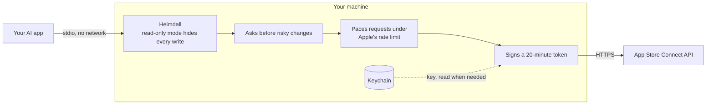
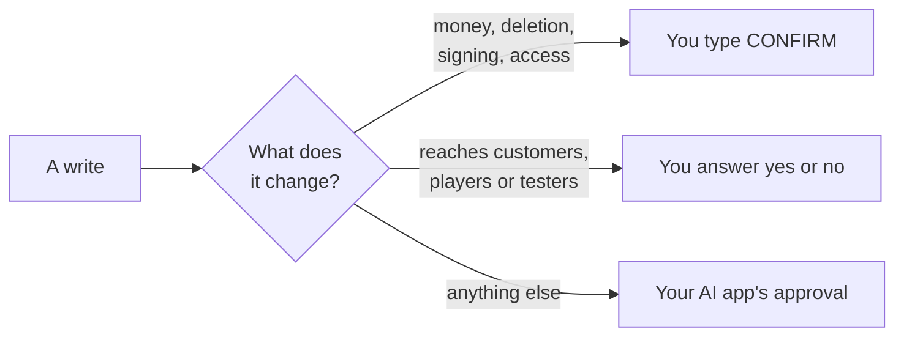
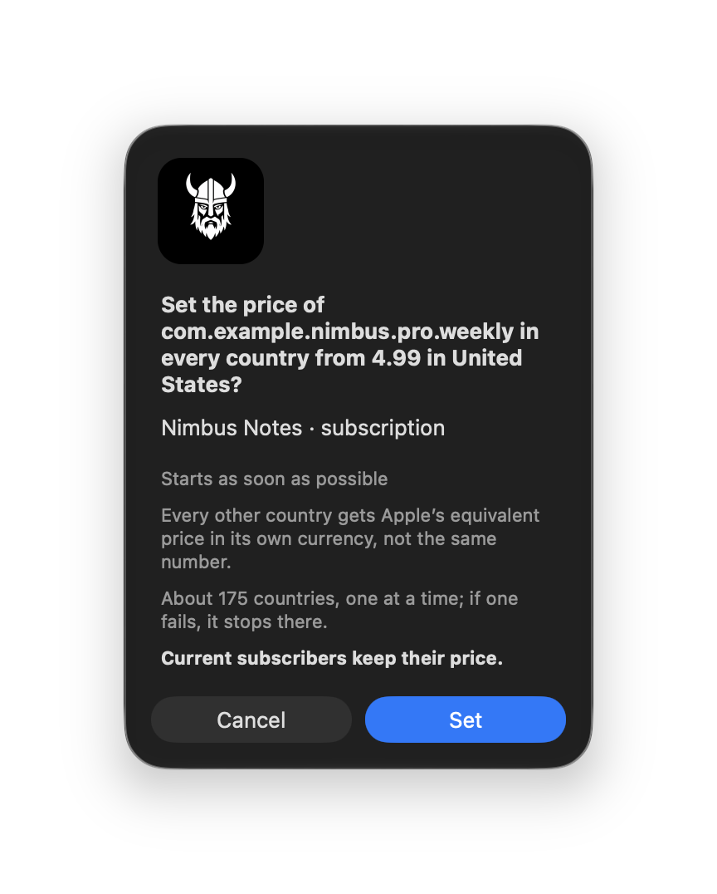
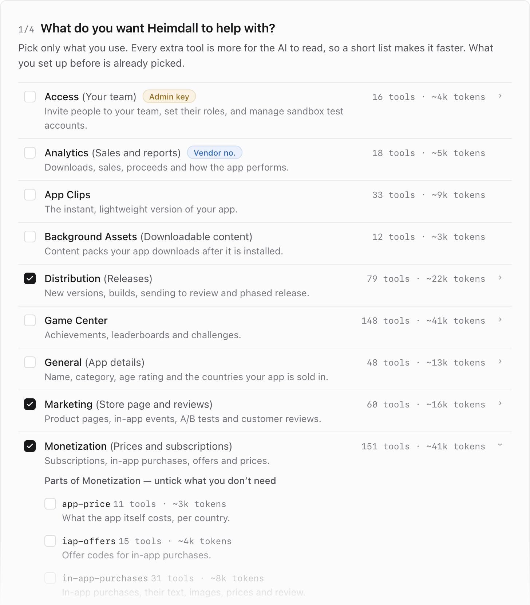

# Heimdall — App Store Connect MCP

**Your whole App Store Connect account, in one app.**

[](https://milowda.com) [](https://nodejs.org) [](https://www.npmjs.com/package/@erayendes/asc-mcp) [](https://github.com/erayendes/app-store-connect-mcp/stargazers) [](https://www.npmjs.com/package/@erayendes/asc-mcp) [](https://github.com/erayendes/app-store-connect-mcp/actions/workflows/ci.yml) [](LICENSE) [](https://cursor.com/en/install-mcp?name=ASC-Default&config=eyJjb21tYW5kIjoibnB4IiwiYXJncyI6WyIteSIsIkBlcmF5ZW5kZXMvYXNjLW1jcCJdfQ==) [](https://insiders.vscode.dev/redirect/mcp/install?name=ASC-Default&config=%7B%22command%22%3A%22npx%22%2C%22args%22%3A%5B%22-y%22%2C%22%40erayendes%2Fasc-mcp%22%5D%7D)

🇬🇧 English · 🇹🇷 [Türkçe](docs/README_tr.md)

> I released Heimdall a few months ago. Since then it has been **downloaded more than 10,000 times** from npm, more than 3,600 of them in the last month alone. It has passed **60 stars** on GitHub, with **41 releases** in 4 months. Thank you all for the interest.

**Ask, and it answers. Tell it, and it's done.**

> - *"Summarize this week's 1-star reviews and draft replies."*
> - *"Which builds are stuck in review?"*
> - *"Raise this subscription's price in every country."*
> - *"What does this subscription cost in each country?"*
> - *"Which screenshots are on the store listing?"*
> - *"Add build 42 to the Internal and External groups."*
> - *"Why did my Xcode Cloud build fail?"*

Almost anything you'd click through App Store Connect to do, you can now just ask your AI to do. More examples in the [Guide](docs/GUIDE_en.md#examples).

<!-- Absolute URL on purpose: npm does not rewrite relative image paths. -->


<sub>A real AI session, sped up. The App Store Connect account is a stand-in so the recording can be public.</sub>

### Heimdall

One package for the **App Store Connect API** and the **App Store Server API (StoreKit 2)**, built from Apple's own OpenAPI specification. **14 profiles, 51 sub-profiles, 786 tools.** Each profile runs as its own small MCP server.

Apple's specification lists 1036 API operations. Heimdall leaves out the 185 that Apple has deprecated or replaced with a newer version, and 19 that repeat another operation from the other side or that no task needs. Of the remaining 832, 734 become tools, and 52 hand-written ones join them: 786 tools in all. The other 98 are covered by the media tools, which do in one call what took several raw ones.

_Sounds complicated, doesn't it? You don't have to think about any of it. Just tell your AI the job you want done._

**Heimdall gives you the whole API, cut by the work you do.** Releases, TestFlight, subscriptions and in-app purchases, the store page and reviews, Game Center, Xcode Cloud, provisioning, webhooks, sales and finance reports: each is a profile.

A big profile splits into sub-profiles, so `monetization:subscription` loads subscriptions without the rest of the money tools. **You pick what you need**, and add or remove profiles whenever you like.

[Profiles](docs/PROFILES_en.md) shows what each one covers, down to every tool. You don't have to memorize any of it, though: ask *"Is there a tool for in-app events?"* and Heimdall tells you which profile has it.

**Not sure which profiles you need?** The [starter packs](docs/PROFILES_en.md#starter-packs) suggest a set for your role.

### Runs on your machine

**Heimdall runs locally.** On a Mac it reads your App Store Connect key from the Keychain, signs a short-lived token and talks to Apple directly. Nothing sits in between, so your key stays with you.



> [!NOTE]
> Give your key the narrowest role that does the job. [Roles](docs/ROLES_en.md) explains what each App Store Connect role can do.

### Asks before risky changes

Before changing a price, giving someone Admin access or deleting something, Heimdall asks you to confirm and shows what will change.



**If your AI app can't show the question,** Heimdall asks in a window of its own on a Mac. The AI can neither see nor press it, and waits until you answer.



More in [Security](.github/SECURITY.md).

### Setup

One command:

```bash
npx -y @erayendes/asc-mcp setup
```

It asks whether to continue in your browser or the terminal. I recommend the browser.

To reach your account you need an [App Store Connect API key](docs/SETUP_en.md#create-an-api-key). Heimdall tells you which role to give it from the tools you pick, so you can start setup before creating the key.

<!-- Absolute URL on purpose: npm does not rewrite relative image paths. -->


<sub>Setup in the browser: pick what you need and see what it costs the AI as you go. All four steps are in [Setup](docs/SETUP_en.md#save-your-credentials-once--the-setup-wizard).</sub>

Setup does two things: it saves your key, and it registers the profiles you pick in the AI apps you pick.

Your AI can do the second half for you with `register`; the key is always yours to hand over, through `setup`.

Want your AI to install it for you, or to use it in [Xcode 27](docs/SETUP_en.md#using-heimdall-in-xcode-27)? Everything else is in [Setup](docs/SETUP_en.md).

If something isn't working, run `npx -y @erayendes/asc-mcp doctor`; it checks your setup without changing anything and tells you the next step.

### About the name and the project
In Norse mythology, **Heimdall** keeps watch over Bifröst, **the rainbow bridge that links Asgard to the nine realms**. Here, his job is to guard the road between your App Store Connect account and your machine. That's where the name comes from.

I build Heimdall on my own, in the evenings, and release it free and open source under the MIT license.
If it gets you out of the App Store Connect dashboard, it has done its job.

### License

[MIT](LICENSE) © Eray Endes

[SECURITY.md](.github/SECURITY.md) | [SUPPORT.md](.github/SUPPORT.md) | [CHANGELOG.md](docs/CHANGELOG.md) | [CONTRIBUTING.md](.github/CONTRIBUTING.md) | [CODE_OF_CONDUCT.md](.github/CODE_OF_CONDUCT.md) | [GOVERNANCE.md](.github/GOVERNANCE.md)

Heimdall is generated from the App Store Connect OpenAPI specification published by Apple Inc. App Store Connect, TestFlight, StoreKit, Xcode and Game Center are trademarks of Apple Inc. This project is not affiliated with Apple Inc.
