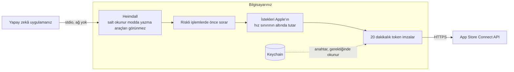
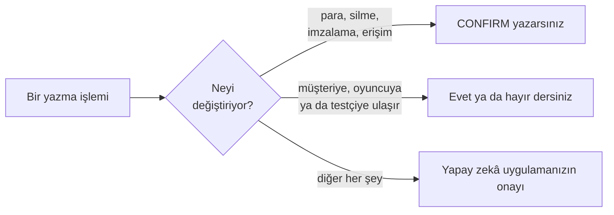
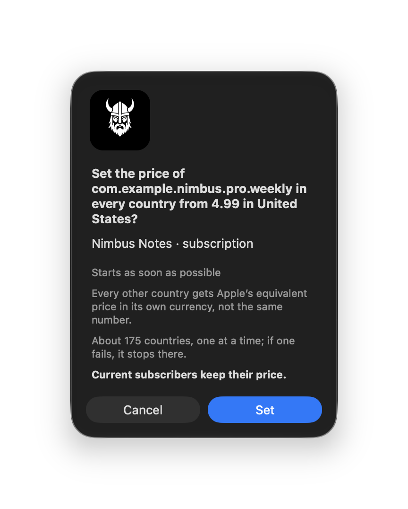
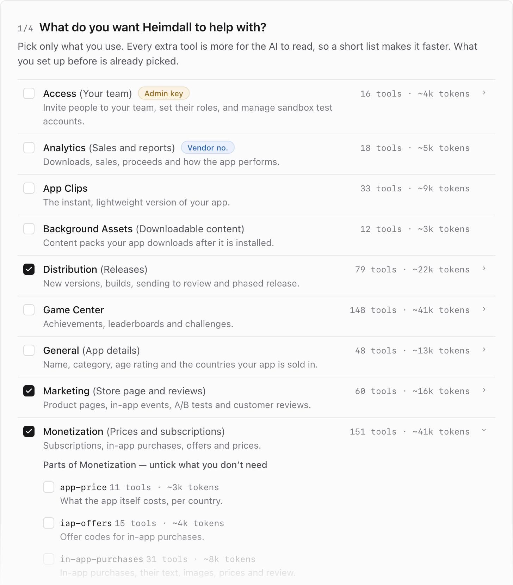

# Heimdall — App Store Connect MCP

**App Store Connect hesabınızın tamamı, tek bir uygulamada.**

[](https://milowda.com) [](https://nodejs.org) [](https://www.npmjs.com/package/@erayendes/asc-mcp) [](https://github.com/erayendes/app-store-connect-mcp/stargazers) [](https://www.npmjs.com/package/@erayendes/asc-mcp) [](https://github.com/erayendes/app-store-connect-mcp/actions/workflows/ci.yml) [](../LICENSE) [](https://cursor.com/en/install-mcp?name=ASC-Default&config=eyJjb21tYW5kIjoibnB4IiwiYXJncyI6WyIteSIsIkBlcmF5ZW5kZXMvYXNjLW1jcCJdfQ==) [](https://insiders.vscode.dev/redirect/mcp/install?name=ASC-Default&config=%7B%22command%22%3A%22npx%22%2C%22args%22%3A%5B%22-y%22%2C%22%40erayendes%2Fasc-mcp%22%5D%7D) [](https://glama.ai/mcp/servers/erayendes/app-store-connect-mcp)

🇬🇧 [English](../README.md) · 🇹🇷 Türkçe

> Heimdall'ı birkaç ay önce yayınladım. O günden bu yana npm'den **10.000'den fazla indirildi**; yalnızca son bir ayda 3.600'den fazla. GitHub'da **60'ı aşkın yıldız** topladı ve 4 ayda **41 sürüm** çıktı. Bu ilgi için hepinize teşekkür ederim.

**Sorun yanıtlasın, isteyin yapsın.**

> - *"Bu haftanın 1 yıldızlı yorumlarını özetleyin ve cevap taslakları hazırlayın."*
> - *"Hangi build'ler incelemede takıldı?"*
> - *"Bu aboneliğin fiyatını her ülkede artırın."*
> - *"Bu abonelik her ülkede kaça?"*
> - *"Mağaza sayfasında hangi ekran görüntüleri var?"*
> - *"42 numaralı build'i Internal ve External gruplarına atayın."*
> - *"Xcode Cloud build'im neden patladı?"*

Yani App Store Connect ekranlarında yapabildiğiniz işlerin neredeyse tamamını artık yapay zekâya söyleyerek yaptırabilirsiniz. Daha fazla kullanım örneği için [Rehber](GUIDE_tr.md#örnekler)i inceleyin.

<!-- Absolute URL on purpose: npm does not rewrite relative image paths. -->


<sub>Gerçek bir yapay zekâ oturumu, hızlandırılmış. Hesap, kayıt herkese açık olabilsin diye temsili bir hesap.</sub>

### Heimdall

Apple'ın kendi OpenAPI spesifikasyonu (**App Store Connect API** ve **App Store Server API (StoreKit 2)**) kullanılarak oluşturulmuş **14 profil altında 51 alt profil ve 790 araç** içeren tek bir pakettir; her profil kendi küçük MCP sunucusu olarak çalışır.

Apple'ın API'sinde 1040 işlem var. Heimdall, Apple'ın kullanımdan kaldırdığı ya da yeni sürümüyle değiştirdiği 185 tanesini ve aynı işi yapan ya da hiçbir işe yaramayan 19 tanesini dışarıda bırakıyor. 

Kalan 836 işlemden 738'ü araca dönüşüyor. Üstüne elle yazılmış 52 araç ekleniyor. Toplam 790 araç. Geri kalan 98 işlemi, birkaç ham çağrının işini tek çağrıda yapan medya araçları karşılıyor. 

_Kulağa ne kadar karışık geliyor değil mi? Ama sizin bunları düşünmenize gerek yok. Sadece yapay zekâya yapmasını istediğiniz işi verin._

**Heimdall, API'nin tamamını yaptığınız işe göre bölerek verir.** Sürümler, TestFlight, abonelikler ve uygulama içi satın almalar, mağaza sayfası ve yorumlar, Game Center, Xcode Cloud, provisioning, webhook'lar, satış ve finans raporları: her biri bir profil. 

Büyük profiller alt profillere ayrılır; örneğin `monetization:subscription` yalnızca abonelikleri yükler, gelirle ilgili diğer araçları getirmez. **İstediklerinizi siz seçersiniz** ve istediğiniz zaman ekleyip çıkarırsınız.

Hangi profilin neyi kapsadığını, araç araç görmek için [Profiller](PROFILES_tr.md) dokümanına bakabilirsiniz.
Ama örneğin *"in-app event için bir araç var mı?"* diye sorarsanız Heimdall o aracın hangi profilde olduğunu zaten söyler.

Eğer **hangi profile ihtiyacınız olduğundan emin değilseniz** [başlangıç paketleri](PROFILES_tr.md#başlangıç-paketleri) işinize yarayabilir.

### Yerelde çalışır

**Heimdall yerelde çalışır**. App Store Connect için gerekli olan anahtarı macOS'ta Keychain'den okur. Kısa ömürlü bir token imzalar ve doğrudan Apple ile konuşur. Arada hiçbir şey olmaz, anahtarınız sadece sizde kalır.



> [!NOTE]
> Anahtara en az yetkiyi vermeye çalışın. App Store Connect [rol yetkileri](ROLES_tr.md)ni incelediğinizden emin olun.

### Riskli işlemlerde önce sorar

Fiyat değiştirmek, birine Admin yetkisi vermek ya da bir şeyi silmek istediğinizde önce onay ister ve neyin değişeceğini gösterir. 



**Yapay zekâ uygulamanız soruyu gösteremiyorsa** Heimdall, Mac'te kendi penceresiyle sorar. Yapay zekâ bu pencereyi ne görebilir ne de basabilir; siz cevap verene kadar bekler.



Detaylar için → [Güvenlik](../.github/SECURITY.md#türkçe).

### Kurulum

Tek komut.

```bash
npx -y @erayendes/asc-mcp setup
```

Komut size tarayıcıda mı terminalde mi devam etmek istediğinizi sorar. En iyi deneyim için tarayıcıyı öneririm.

Hesabınıza erişmek için bir [App Store Connect API anahtarı](SETUP_tr.md#api-anahtarı-oluşturun) gerekir. Heimdall seçtiğiniz araçlara göre anahtara hangi rolü vermeniz gerektiğini söyler. Yani anahtarı oluşturmadan da setup'ı başlatabilirsiniz. 

<!-- Absolute URL on purpose: npm does not rewrite relative image paths. -->


<sub>Tarayıcıda kurulum: neye ihtiyacınız olduğunu seçin, yapay zekâya maliyetini seçtikçe görün. Dört adımın hepsi [Kurulum](SETUP_tr.md#kimlik-bilgisini-bir-kez-kaydedin--setup-sihirbazı) sayfasında.</sub>

Setup iki iş yapar: anahtarınızı kaydeder ve seçtiğiniz profilleri, yine seçtiğiniz yapay zekâ uygulamalarına kaydeder. 

İkinci kısmı yapay zekânız `register` ile sizin yerinize yapabilir; anahtarı ise her zaman siz, `setup` ile verirsiniz.

Heimdall'ı yapay zekânıza kurdurmak ya da [Xcode 27'de kullanmak](SETUP_tr.md#xcode-27de-heimdall-kullanmak) için diğer tüm kurulum detayları [Kurulum](SETUP_tr.md) dokümanında.

Bir şey yolunda gitmiyorsa `npx -y @erayendes/asc-mcp doctor` çalıştırın; hiçbir şeyi değiştirmeden kurulumu kontrol eder ve sıradaki adımı söyler.

### İsim ve proje hakkında
**Heimdall**, İskandinav mitolojisinde Asgard ile **dokuz diyarı birbirine bağlayan gökkuşağı köprüsü** Bifröst'ün bekçisidir. Bu projedeki görevi, App Store Connect hesabınızı makinenize bağlayan yolları tutmak. Adını oradan alıyor.

Projeyi akşamları tek başıma geliştiriyorum ve ücretsiz, açık kaynak ve MIT lisanslı olarak yayınlıyorum.
Heimdall sizi App Store Connect panelinden kurtardıysa tam işlevini yerine getirmiş demektir.

### Lisans

[MIT](../LICENSE) © Eray Endes

[SECURITY.md](../.github/SECURITY.md#türkçe) | [SUPPORT.md](../.github/SUPPORT.md#türkçe) | [CHANGELOG.md](CHANGELOG.md#türkçe) | [CONTRIBUTING.md](../.github/CONTRIBUTING.md#türkçe) | [CODE_OF_CONDUCT.md](../.github/CODE_OF_CONDUCT.md#türkçe) | [GOVERNANCE.md](../.github/GOVERNANCE.md#türkçe)

Heimdall, Apple Inc.'in yayımladığı App Store Connect OpenAPI spesifikasyonundan üretilir. App Store Connect, TestFlight, StoreKit, Xcode ve Game Center, Apple Inc.'in ticari markalarıdır. Bu proje Apple Inc. ile bağlantılı değildir.
