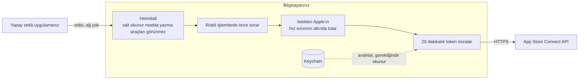
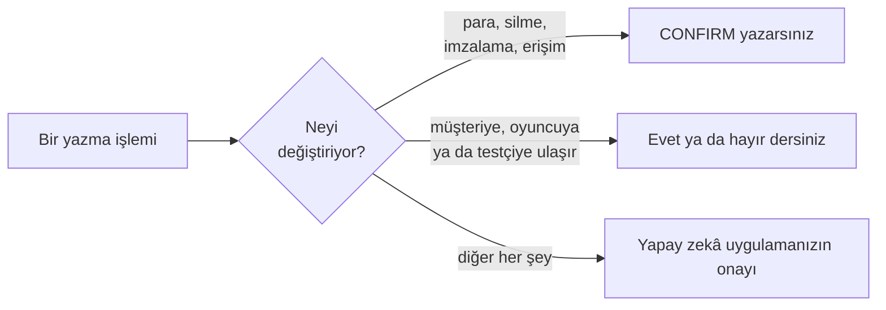
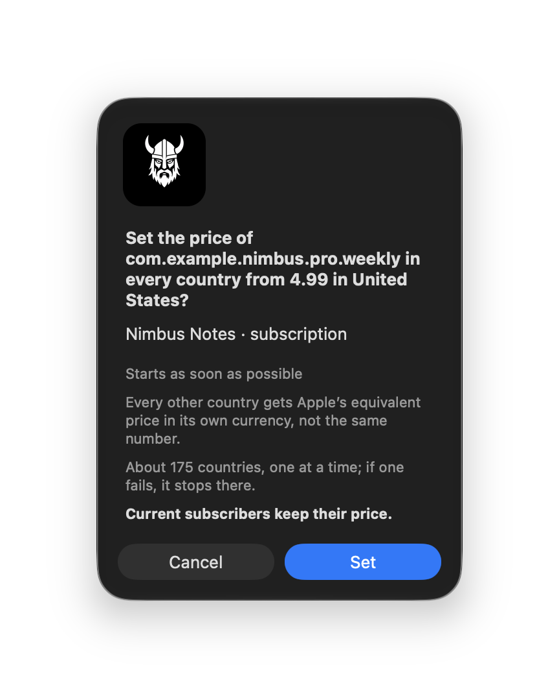
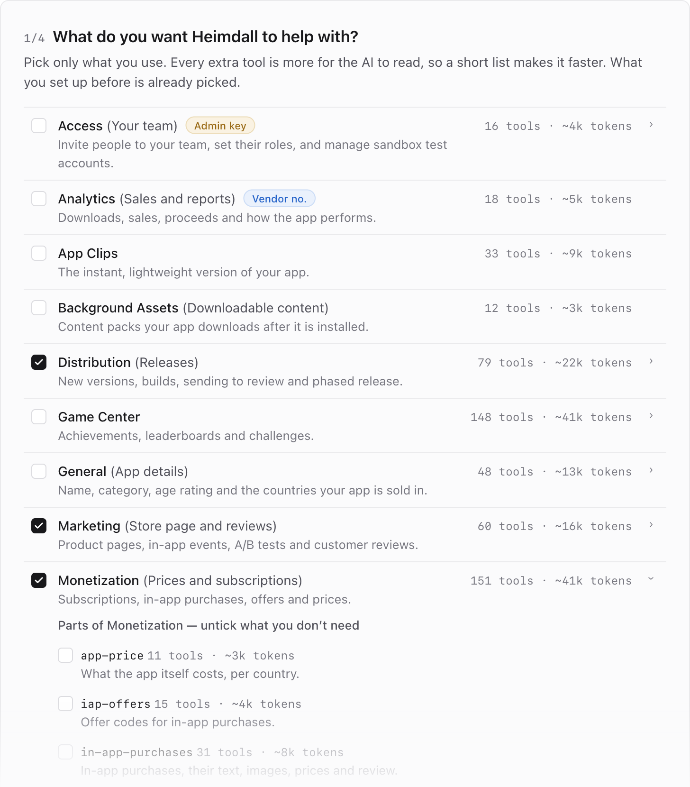

# Heimdall: App Store Connect MCP

**App Store Connect'i yapay zekânızla yönetin. Parayla ilgili her değişiklik sizin onayınızı bekler.**

175 ülkede fiyat, teklif ve abonelik, tek cümleyle.

Heimdall, [fastlane](https://fastlane.tools/)'in yerini almaz. CI fastlane'de kalır, elle yaptığınız her şey Heimdall'a geçer.

[](https://www.npmjs.com/package/@erayendes/asc-mcp)
[](https://www.npmjs.com/package/@erayendes/asc-mcp)
[](https://github.com/erayendes/app-store-connect-mcp/actions/workflows/ci.yml)
[](../LICENSE)
[](https://milowda.com)

🇬🇧 [English](../README.md) · 🇹🇷 Türkçe

```bash
npx -y @erayendes/asc-mcp setup
```

[](https://cursor.com/en/install-mcp?name=ASC-Default&config=eyJjb21tYW5kIjoibnB4IiwiYXJncyI6WyIteSIsIkBlcmF5ZW5kZXMvYXNjLW1jcCJdfQ==)
[](https://insiders.vscode.dev/redirect/mcp/install?name=ASC-Default&config=%7B%22command%22%3A%22npx%22%2C%22args%22%3A%5B%22-y%22%2C%22%40erayendes%2Fasc-mcp%22%5D%7D)

Bu iki düğme Cursor'a ya da VS Code'a **ASC-Default**'u ekler: core, general ve analytics, salt okunur. Anahtar olmadan açılır; hesabınızı okumak için anahtar gerekir. Anahtarınızı vermek ve profillerinizi seçmek için bir terminalde `npx -y @erayendes/asc-mcp setup` komutunu çalıştırın; setup seçtiğiniz profilleri kaydettiği için ardından ASC-Default kaydını kaldırın.

<!-- Absolute URL on purpose: npm does not rewrite relative image paths. -->


<sub>Gerçek bir yapay zekâ oturumu, hızlandırılmış. Hesap, kayıt herkese açık olabilsin diye temsili bir hesap.</sub>

|  | Heimdall | Tipik bir App Store Connect MCP'si | [asc CLI](https://github.com/rorkai/App-Store-Connect-CLI) |
|---|---|---|---|
| **Yazmadan önce** | Fiyat, silme, imzalama ve erişim değişikliklerinde CONFIRM yazarsınız; müşteriye ulaşan her şey için evet ya da hayır dersiniz. `--read-only` bütün yazma araçlarını gizler. Yapay zekâ uygulaması bu soruyu gösteremediğinde Mac'te yapay zekânın basamadığı bir onay penceresi açılır. | Çoğunlukla yapay zekâ uygulamasının kendi araç onayından başka bir şey yok; olsa olsa salt okunur bir mod ya da yapay zekânın kendisinin verebildiği bir `confirm=true` parametresi. | Ajanın kendisinin geçtiği `--confirm` bayrakları. |
| **StoreKit 2 ve fiyatlandırma** | Müşteri işlemleri için App Store Server API araçları. Tek çağrı yaklaşık 175 ülkede fiyatı okur ya da ayarlar; teklifler ve yeni abonelikler de birer çağrı. | API'nin elle seçilmiş bir dilimi (27 araçtan birkaç yüz araca kadar). İncelediğimiz diğer sunucuların belgelerinde StoreKit 2 Server API desteği görünmüyor. | StoreKit Server API'yi komut satırından kapsar. |
| **Kurulum** | `npx -y @erayendes/asc-mcp setup`. Tarayıcıdaki sihirbaz anahtarı macOS Keychain'de saklar ve Heimdall'ı bulduğu her yapay zekâ uygulamasına kaydeder. | Yapay zekâ uygulamasının JSON yapılandırmasını elle düzenler ve anahtarınızın yolunu yazarsınız. | CLI'yi ve Agent Skills'i kurarsınız; App Store Connect web oturumu üzerinden API anahtarı da oluşturabilir. |

Daha ayrıntılı karşılaştırma için [Karşılaştırma](COMPARISON_tr.md) sayfasına bakın.


<sub>Tek bir çıpa fiyat, gerisini Apple eşitliyor; siz CONFIRM yazana kadar hiçbir şey yazılmıyor. Kayıt temsili bir hesapla yapıldı.</sub>

> **Heimdall 3.1 çıktı.** Anahtar olmadan salt okunur bir varsayılanla başlayabilir, kurulumunuzu `doctor` ile kontrol edebilir ve Cursor'a ya da VS Code'a tek tıkla kurabilirsiniz. Üç ayda npm'den 6.800'den fazla indirme için teşekkür ederim. Ne değiştiğinin hepsi [sürüm notlarında](CHANGELOG.md); gördüğünüz her tuhaflığı [yazarsanız](https://github.com/erayendes/app-store-connect-mcp/issues) çok sevinirim.

**Sorun yanıtlasın, isteyin yapsın.**

> - *"Bu haftanın 1 yıldızlı yorumlarını özetle ve cevap taslakları hazırla."*
> - *"Hangi build'ler incelemede takıldı?"*
> - *"Bu aboneliğin fiyatını her ülkede artır."*
> - *"Bu abonelik her ülkede kaça?"*
> - *"Mağaza sayfasında hangi ekran görüntüleri var?"*
> - *"42 numaralı build'i Internal ve External gruplarına ata."*
> - *"Xcode Cloud build'im neden patladı?"*

Yani App Store Connect ekranlarında yapabildiğiniz işlerin neredeyse tamamını artık yapay zekâya söyleyerek yaptırabilirsiniz. Daha fazla kullanım örneği için [Rehber](GUIDE_tr.md#örnekler)i inceleyin.

### Heimdall

Apple'ın kendi OpenAPI spesifikasyonu (**App Store Connect API** ve **App Store Server API (StoreKit 2)**) kullanılarak oluşturulmuş **14 profil altında 51 alt profil ve 786 araç** içeren tek bir pakettir; her profil kendi küçük MCP sunucusu olarak çalışır.

Apple'ın spesifikasyonunda 1036 API operasyonu var. Heimdall, Apple'ın kullanımdan kaldırdığı ya da yeni sürümüyle değiştirdiği 185 tanesini ve aynı ilişkiye öbür uçtan erişen ya da hiçbir işte gerekmeyen 19 tanesini dışarıda bırakıyor. Kalan 832 işlemden 734'ü araca dönüşüyor, üstüne elle yazılmış 52 araç ekleniyor: toplam 786 araç. Geri kalan 98 işlemi, birkaç ham çağrının işini tek çağrıda yapan medya araçları karşılıyor.

Çoğu muadili API'nin elle seçilmiş bir araç dilimini sunar. Bu kürasyon ihtiyaç duyacağınız o uç noktaya kadar işe yarar. Ama **o uç nokta geldiğinde çözümü bulmak için alternatifler arasında kaybolur gidersiniz.**

**Heimdall** tam tersini yapar, **API'nin tamamını yaptığınız işe göre bölerek verir.** Sürümler, TestFlight, abonelikler ve uygulama içi satın almalar, mağaza sayfası ve yorumlar, Game Center, Xcode Cloud, provisioning, webhook'lar, satış ve finans raporları: her biri bir profil. Büyük profiller alt profillere ayrılır; örneğin `monetization:subscription` yalnızca abonelikleri yükler, gelirle ilgili öbür araçları getirmez. **İstediklerinizi siz seçersiniz** ve istediğiniz zaman ekleyip çıkarırsınız.

Profil argümanı vermediğinizde Heimdall, **ASC-Default** adıyla `core` + `general` + `analytics` profillerini tek süreçte, zorunlu salt okunur olarak başlatır. `ASC_READ_ONLY=false` olsa bile yazma araçları listelenmez. Kimlik bilgileri olmadan araçları listeleyebilirsiniz; hesabınızdaki verileri okumak için kimlik bilgileri gerekir. Tam kullanım için bir terminalde `npx -y @erayendes/asc-mcp setup` komutunu çalıştırın ve profillerinizi seçin. Bilinmeyen veya kaldırılmış bir profil adı hâlâ yalnızca `asc__profile_unknown` bildirimini gösterir.

**ASC-Core her profille gelir.** Uygulamalarınızı bulmak, bütün araçlarda aramak ve medya araçları hangi işi yaparsanız yapın aynıdır. Bu yüzden ayrı bir sunucuda bir kez çalışırlar; setup bu sunucuyu seçtiklerinizin yanına kaydeder. Medya araçları App Store Connect'in aldığı her ekran görüntüsünü, videoyu, görseli ve dosyayı yönetir: mağaza sayfası medyası, App Clip ve Game Center görselleri, uygulama içi satın alma ve abonelik görselleri, inceleme ekran görüntüleri ve ekleri, şifreleme belgeleri, routing coverage dosyası, background asset ve build yükleme dosyaları ([tam liste](MEDIA_TARGETS_tr.md)).

Hangi profilin neyi kapsadığını, araç araç görmek için [Profiller](PROFILES_tr.md) dokümanına bakabilirsiniz.
Ama örneğin *"in-app event için bir araç var mı?"* diye sorarsanız Heimdall o aracın hangi profilde olduğunu zaten söyler.

Eğer **hangi profile ihtiyacınız olduğundan emin değilseniz** [başlangıç paketleri](PROFILES_tr.md#başlangıç-paketleri) işinize yarayabilir.

### Yerelde çalışır

MCP rehberleri genelde uzak HTTP sunucularını önerir.
**Heimdall yerelde çalışır**. App Store Connect için gerekli olan anahtarları Keychain'den okur. Kısa ömürlü bir token imzalar ve doğrudan Apple ile konuşur. Arada hiçbir şey olmaz, anahtarınız sadece sizde kalır.



> [!NOTE]
> Anahtara en az yetkiyi vermeye çalışın. App Store Connect [rol yetkileri](ROLES_tr.md)ni incelediğinizden emin olun.

### Riskli işlemlerde önce sorar

Fiyat değiştirmek, birine Admin yetkisi vermek ya da bir şeyi silmek istediğinizde önce onay ister ve neyin değişeceğini gösterir. Varsayılan olarak iki şekilde sorar:

- **CONFIRM yazmanızı ister:** gelir, silme, kod imzalama ve erişim değişikliklerinde ve geri alınamayan birkaç adımda: bir sürümü yayınlamak, ön siparişi bitirmek, bir build'in süresini bitirmek. Bir build'i tek çağrıda beta gruplarına atamak (`testflight__assign_build_to_groups`) da CONFIRM ister.
- **Evet ya da hayır sorar:** müşteriye, oyuncuya ya da testçiye ulaşan diğer adımlarda: bir şeyi incelemeye göndermek, yeni bir abonelik ya da uygulama içi satın alma sürümü başlatmak, kademeli yayını değiştirmek, bir build'i dış incelemeye göndermek, bir ülkede satışa açmak, ürün sayfası testini değiştirmek, bir oyuncu adına skor ya da başarım göndermek, aboneliğini iptal eden müşteriye gösterilen mesajı değiştirmek, bir müşteri yorumuna yanıt vermek.

Geri kalan her şeyde kullandığınız yapay zekâ uygulamasının kendi onay sistemi devrededir.



**Yapay zekâ uygulamanız soruyu gösteremiyorsa** (Claude Desktop'taki Code sekmesi gibi) Heimdall, Mac'te kendi penceresiyle sorar. Düğmesi ne yapacağını söyler: Remove, Upload, Delete. Yapay zekâ bu pencereyi ne görebilir ne de basabilir; siz cevap verene kadar bekler.



Detaylar için → [Güvenlik](../.github/SECURITY.md#türkçe).

### Kurulum

Tek komut.

```bash
npx -y @erayendes/asc-mcp setup
```

<!-- Absolute URL on purpose: npm does not rewrite relative image paths. -->


<sub>Tarayıcıda kurulum: neye ihtiyacınız olduğunu seçin, yapay zekâya maliyetini seçtikçe görün. Dört adımın hepsi [Kurulum](SETUP_tr.md#kimlik-bilgisini-bir-kez-kaydedin--setup-sihirbazı) sayfasında.</sub>

2.x'ten mi geliyorsunuz? Setup'ı bir kez daha çalıştırıp profillerinizi yeniden seçin; eski profiller artık yok. 2.x'te kalmak isterseniz `@erayendes/asc-mcp@2.8.0` kullanın.

Tarayıcıda mı (önerilir) terminalde mi devam etmek istediğinizi sorar. Bir [App Store Connect API anahtarı](SETUP_tr.md#api-anahtarı-oluşturun) gerekir; tarayıcı sayfası seçtiklerinize göre anahtara hangi rolü vermeniz gerektiğini söyler, yani anahtarı oluşturmadan da setup'ı başlatabilirsiniz. Node.js 20.19 veya üstü gerekir.

Setup iki iş yapar: anahtarınızı kaydeder ve seçtiğiniz profilleri, yanlarına ASC-Core'u da ekleyerek bulduğu her yapay zekâ uygulamasına kaydeder. İkinci kısmı yapay zekânız `register` ile sizin yerinize yapabilir; anahtarı ise her zaman siz, `setup` ile verirsiniz.

Heimdall'ı yapay zekânıza kurdurmak ya da [Xcode 27'de kullanmak](SETUP_tr.md#xcode-27de-heimdall-kullanmak) için diğer tüm kurulum detayları [Kurulum](SETUP_tr.md) dokümanında.

### İsim ve proje hakkında
**Heimdall**, İskandinav mitolojisinde Asgard ile **dokuz diyarı birbirine bağlayan gökkuşağı köprüsü** Bifröst'ün bekçisidir. Bu projedeki görevi, App Store Connect hesabınızı makinenize bağlayan yolları tutmak. Adını oradan alıyor.

Projeyi akşamları tek başıma geliştiriyorum ve ücretsiz, açık kaynak ve MIT lisanslı olarak yayınlıyorum.
Heimdall sizi App Store Connect panelinden kurtardıysa tam işlevini yerine getirmiş demektir.

### Lisans

[MIT](../LICENSE) © Eray Endes

[SECURITY.md](../.github/SECURITY.md#türkçe) | [SUPPORT.md](../.github/SUPPORT.md#türkçe) | [CHANGELOG.md](CHANGELOG.md#türkçe) | [CONTRIBUTING.md](../.github/CONTRIBUTING.md#türkçe) | [CODE_OF_CONDUCT.md](../.github/CODE_OF_CONDUCT.md#türkçe) | [GOVERNANCE.md](../.github/GOVERNANCE.md#türkçe)

Heimdall, Apple Inc.'in yayımladığı App Store Connect OpenAPI spesifikasyonundan üretilir. App Store Connect, TestFlight, StoreKit, Xcode ve Game Center, Apple Inc.'in ticari markalarıdır. Bu proje Apple Inc. ile bağlantılı değildir.
